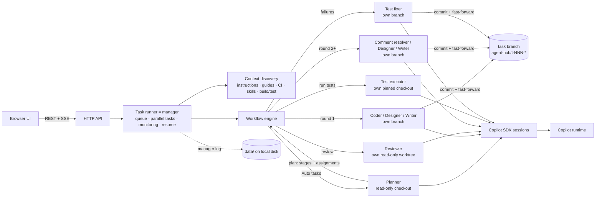

# Copilot Agent Hub

A local web service that runs **teams of sub-agents** on your repositories with the
[GitHub Copilot SDK](https://docs.github.com/en/copilot/how-tos/copilot-sdk). A **manager agent** reads your
request, decides which sub-agents to create, assigns their work and monitors them; the sub-agents iterate
author ↔ reviewer (or execute ↔ fix) until the work is approved or the tests pass.

| Task type | Sub-agents |
| --- | --- |
| **Auto** (default) | The **manager's planner** reads the request and the repository, picks the stages below (for example *Coding → Execute & verify*), writes each team's assignment, and the hub creates those sub-agents |
| **Coding** | **Coder** implements the request · **Code reviewer** reviews each commit · **Comment resolver** fixes review comments (same model as the coder by default) |
| **Execute & verify** | **Test executor** runs the test automation and verifies the results · **Test fixer** fixes failures at the root cause · the executor re-runs and checks the fixes are legitimate, until everything passes |
| **Design** | **Designer** writes the design document and revises it · **Design reviewer** critiques it until a finalized version is approved |
| **Document** | **Technical writer** writes documentation grounded in the repository · **Doc reviewer** checks accuracy and clarity until it is approved |
| **Design → Coding** | Designer + design reviewer finalize the design, then coder + code reviewer + comment resolver implement it |

Every sub-agent works on **its own branch** (reviewers and the test executor in their own worktree pinned
to the commit under review/test), and every task has its own branches and worktrees, so **several tasks
can run on the same repository at the same time** without touching your checkout. Agents use the
repository's own guidance (instruction files, guides, CI pipelines, design docs, skills, build/test
commands) and fall back to the hub's best-practice skills for coding, code review, test execution and
fixing, system design and technical writing. Design and document deliverables are **light-themed HTML
pages** with Mermaid diagrams, rendered in the UI.

You sign in with GitHub in the browser, choose the LLMs, register repositories or folders, submit tasks,
and watch each one live: which agent is working, what it is doing right now (planning, coding, reviewing,
running tests, fixing failures), its latest message, streaming output and tool calls; when it finishes,
the result. The **Agents** page shows the same work from the agents' side: a live hierarchy (or pipeline)
of the manager, the tasks and their sub-agents, and the manager's conversation with them. Everything
(settings, repositories, each task's last state and history) is saved on local disk and survives restarts.

## Quick start

Requirements: Node.js **22.18+** (the TypeScript sources run directly), `git` on `PATH`, and a GitHub
Copilot subscription. The SDK ships its own Copilot runtime, so no separate CLI install is needed.

```powershell
cd agent-hub         # this folder of the WindowsVMAgent repository
npm install
npm start            # http://localhost:4600
```

1. **Sign in**: click **Sign in with GitHub** and approve access in the GitHub tab that opens.
   Approve right away; the runtime only waits a limited time.
2. **Choose models**: pick the author model (designer/writer/coder) and the reviewer model. Using a different
   model for reviews gives a genuine second opinion. The comment resolver / test fixer and the manager
   use the author model unless you pick others in Settings.
3. **Repositories**: register a local git repository, clone one from a URL, or register a plain folder
   and opt in to "initialize git" (git init + an initial commit of its current files).
4. **New task**: keep **Auto** to let the manager decide which agents to create, or choose a type; pick the
   repository, base branch and description, and optionally per-task models and the maximum number of
   review rounds / test runs.

## How a task runs



0. **Plan** (Auto tasks): the manager's planner inspects the repository read-only and calls `submit_plan`
   with the stages to run (design, coding, testing, document; they always run in that order), its
   rationale, and an assignment for each stage's team (scope, acceptance criteria, the exact test
   commands). The hub creates the corresponding sub-agents and gives each its assignment. If the planner
   does not submit a plan, the hub derives the stages from keywords in the request.
1. **Context**: at the task's base commit the hub looks for instruction files (`AGENTS.md`,
   `.github/copilot-instructions.md`, `.github/instructions/*.instructions.md`, `CLAUDE.md`), guides
   (`CONTRIBUTING.md`, `ARCHITECTURE.md`, `TESTING.md`, `README.md`, CI pipelines, …), design docs/ADRs,
   repository skills (`.github/skills`, `.copilot/skills`, `.claude/skills`, `skills`) and build/test
   commands (package scripts, .NET, Go, Rust, Python, Maven/Gradle, Makefile, Pester). Instruction files
   are loaded by the runtime automatically; the rest is listed in each agent's first prompt, and
   repository skills are passed to every agent. See the **Context** tab of a task.
2. **Author turn**: the coder (round 1), the comment resolver (rounds with open code comments), the
   designer or the technical writer works on its own branch and finishes by calling the `submit_work`
   tool with a summary, the validation it ran, and a response (`addressed` or `declined` plus a note) for
   **every** open comment ID. Submissions that skip a comment are rejected so the agent must fix them.
3. **Commit**: the hub commits the agent's work on the agent's branch and fast-forwards the task branch
   to it (one commit per round). Round commits skip repository commit hooks (`--no-verify`) so a hook
   cannot stall the loop; agents run the project's build/tests themselves, and your normal hooks still
   apply when you merge or push.
4. **Review turn**: the reviewer's own worktree is pinned (detached) to the exact commit under review. It
   gets the diff (the full diff, or the round's incremental diff on re-review) and the author's
   responses, and finishes by calling `submit_review` with a verdict (`approve` / `request_changes`) and
   comments (severity, file, line, body), which get IDs such as `C3` (code), `D2` (design) or `W1`
   (document). It cannot approve while blocker/major comments remain.
5. **Iterate**: open code comments go to the comment resolver (design and document comments back to
   their author) until the reviewer approves or the round budget is used up. **Continue review loop**
   runs more rounds later in fresh sessions; **Retry** resumes failed, cancelled or interrupted tasks from
   the last completed step.
6. **Result**: the task branch, commits, diff stat, test results and final summary (one section per stage),
   with ready-to-copy `git` commands to inspect and merge. Design and document tasks keep every document
   version (v1, v2, … final).

Each agent keeps one Copilot session per stage, so it remembers earlier rounds; a comment resolver or test
fixer that starts fresh gets the request, the previous summary and the diff so far. If an agent ends a turn
without calling its submit tool, the hub nudges it, and after two attempts derives the result from its
last message (a test run without structured results counts as *blocked*, never as passed). If an agent
asks a question (`ask_user`), the task shows **Needs your input**; answer in the UI, or after the
configured timeout the agent proceeds on its own judgment.

## Execute & verify: running test automation

The testing stage (the **Execute & verify** task type, or chosen by the manager for Auto tasks) loops
between two agents:

1. **Test executor** — works in its own checkout pinned to the commit under test, may run any setup,
   build and test command (installing dependencies is fine) but may not edit files or move git state. It
   finds the right commands (the request and the manager's assignment first, then package scripts,
   Makefiles, test projects, Pester tests, CI pipelines), runs the complete suite, and **verifies** the
   outcome instead of trusting exit codes: zero tests discovered is a failure, skipped tests are noted,
   suspected flaky tests are re-run. It reports through `submit_test_results`: status (`passed`,
   `failed`, `blocked`), the exact commands, counts, an output excerpt, and one entry per failure with
   the error and a triage category — `product-bug`, `test-bug`, `environment`, `flaky` or `integrity` —
   plus a suggested fix. Failures get IDs `T1`, `T2`, …
2. **Test fixer** — on its own branch, fixes each failure at its root cause (the product code when its
   behavior is wrong, the test only when the test itself is wrong, with a justification), re-runs the
   failing tests, and responds to every failure ID (`addressed`, or `declined` with what is needed, for
   example a missing tool or credential).
3. **Verification** — the executor re-runs the **complete** suite at the fixer's commit and inspects the
   fixer's diff: deleted or skipped tests, weakened assertions, swallowed errors or hard-coded results are
   reported as `integrity` failures. The stage passes only when everything requested ran and passed.

If the fixer declines every failure without changing anything, the stage stops instead of re-running
unchanged code. **Continue fixing** runs more fix-and-verify rounds later (for example after you install
a missing tool).

## Agents view: the manager and its sub-agents

The **Agents** page shows the work from the agents' side, updated live over Server-Sent Events:

- **Stats**: whether the manager is online, running/queued tasks against the parallel-task capacity,
  how many sub-agents are working or waiting for their turn, and recent message volume.
- **Hierarchy** diagram: *You → Manager agent → tasks → sub-agents*. For Auto tasks the manager's
  **planner** appears first under the task, followed by the agents it decided to create. Each agent
  node shows its model, status, what it is doing now, its last instruction from (↓) or report to (↑) the
  manager, and a heartbeat (♥). Active links animate, and every message travels along the edges as a
  colored pulse (plans, manager → agent assignments, agent → manager submissions, verdicts and test
  results). Click a node to open the task.
- **Pipeline** mode: one row per task with its stage lanes (author → reviewer ↺ comment resolver;
  test executor ↺ test fixer), the current step highlighted and each round's outcome.
- **Manager ↔ agents** feed: every message the manager exchanges — plans, session starts, assignments,
  submissions, review requests, verdicts, test results, nudges, monitoring check-ins, questions/answers
  and releases — filterable by task.
- **Sub-agents by role**: how many agents of each role are working, waiting or done, and which tasks
  each is handling.

The manager also **monitors** its agents: every minute it checks each working agent and posts a
check-in when one has been silent for 5 minutes (a turn still ends at the configured turn timeout).

## Design and document deliverables (HTML)

Design and document tasks produce a self-contained, **light-themed HTML page** (Settings → Documents
→ Format; Markdown is also available). Before round 1 the hub seeds the file from
[`templates/`](templates): a polished page with callouts, cards, tables, numbered steps and Mermaid
diagram blocks whose sections carry `data-placeholder` markers. The author fills it in, and the hub
rejects a submission while the template is unchanged, placeholders remain, or the title is missing.

The **Document** tab renders every version in a sandboxed iframe (no access to the hub UI or API; only
the hub's local Mermaid copy may run) with a Rendered / HTML source toggle and an **Open ↗** link. The
committed file includes a small Mermaid loader so diagrams also render when the file is opened directly.
Designs go to `docs/designs/` and documents to `docs/` by default (both configurable).

## Agents, branches and worktrees

| What | Where |
| --- | --- |
| Task branch (the result you merge) | `agent-hub/<task>-<slug>`, fast-forwarded after every author round |
| Author agents' own branches | `agent-hub/<task>-<slug>--coder`, `--resolver`, `--designer`, `--writer`, `--fixer` |
| Author worktree | `data/worktrees/<task>/author` (authors switch to their own branch for their turn, so installed dependencies and build output are reused) |
| Reviewer / planner worktree | `data/worktrees/<task>/review`, detached at the commit under review (the base commit for the planner) |
| Test executor worktree | `data/worktrees/<task>/run`, detached at the commit under test; kept across runs so installed dependencies and build output are reused |

Set **Agent isolation** to "own worktree and branch per agent" to give every sub-agent its own worktree
(`data/worktrees/<task>/<role>`) at the cost of more disk and per-agent dependency installs. Tasks never
share worktrees, so up to **Parallel tasks** tasks (default and maximum: 10) run at once, including on the
same repository; further tasks wait in the queue and start in submission order as slots free up. Git
worktree operations on a repository are serialized. When a task completes, its worktrees are removed
(branches are kept) unless you turn **Cleanup** off; failed or cancelled tasks keep their worktrees for
inspection or retry. Don't check out a task branch elsewhere while its task is running.

## Best-practice skills

The hub bundles skills in [`skills/`](skills) that apply when a repository has no guidance of its own;
repository instructions and skills always take precedence:

| Skill | Used by |
| --- | --- |
| `coding-best-practices` | Coder, comment resolver, test fixer |
| `review-comment-resolution` | Comment resolver |
| `code-review` | Code reviewer |
| `test-execution` | Test executor |
| `test-fixing` | Test fixer |
| `system-design` | Designer |
| `design-review` | Design reviewer |
| `technical-writing` | Technical writer |
| `doc-review` | Doc reviewer |

Each agent is asked to load its role's skills at the start; hub skills that don't belong to the role are
disabled for its session. Edit the `SKILL.md` files to tune your team's standards.

## Sign-in options

| Option | How |
| --- | --- |
| GitHub.com (browser OAuth) | **Sign in with GitHub**. The Copilot runtime runs the OAuth flow with a local callback. |
| GitHub Enterprise Cloud | **Sign in to GitHub Enterprise Cloud (*.ghe.com)**, then enter your host. |
| Token | **Use a token instead**: a fine-grained PAT with the *Copilot Requests* permission, or an OAuth token such as `gh auth token`. Classic `ghp_` tokens are not supported. |

The hub runs its runtime with its own Copilot home (`data/copilot-home`), so its sessions, settings and
sign-in are separate from `~/.copilot`. Credentials are stored by the runtime in the OS credential
store. After a successful sign-in the hub restarts its runtime to load the new credential.

## Safety model

- **Read-only reviewers and planner**: file writes are rejected. Shell commands are limited to read-only
  tools and read-only git subcommands (`diff`, `log`, `show`, `status`, …).
- **Test executor**: may run any build/test command in its own pinned checkout, but file edits are
  rejected and git is limited to read-only subcommands (plus `submodule`/`lfs` to fetch test content).
- **Authors** may write only inside their own worktree. `git push`, branch switching (`checkout <branch>`,
  `switch`), `rebase`, `reset --hard`, worktree/remote changes and global git config are rejected.
  Reads outside the worktree and persistent memory are denied. Each agent may still use its own
  session scratch folder under `<copilot home>/session-state` (for example for plans) and read the
  skill folders it was given.
- These are guardrails enforced through the SDK permission callback, **not a sandbox**: author agents
  and the test executor run build/test commands on your machine with your user account. Only register
  repositories you are comfortable letting an agent work on.
- The server binds to `127.0.0.1` and checks the `Host` header (DNS-rebinding protection) and the
  `Origin` + JSON `Content-Type` of mutating requests (CSRF protection). It has no login of its own, so
  don't expose it beyond localhost.

## Configuration

Environment variables:

| Variable | Default | Purpose |
| --- | --- | --- |
| `HUB_PORT` | `4600` | HTTP port |
| `HUB_HOST` | `127.0.0.1` | Bind address (keep it on loopback) |
| `HUB_DATA_DIR` | `./data` | Settings, repositories, tasks, logs, worktrees, clones |
| `HUB_COPILOT_HOME` | `<data>/copilot-home` | Copilot runtime home (sessions, sign-in) |
| `HUB_RUNTIME_LOG_LEVEL` | `error` | Copilot runtime log level |

Settings page: default manager, author, comment-resolver/test-fixer and reviewer/test-executor models,
agent isolation (own branch per agent, or own worktree per agent), worktree cleanup on completion, max
review rounds / test runs (default 3), parallel tasks (default and maximum 10; more tasks are queued), agent turn timeout, question timeout,
resuming interrupted tasks after a restart (default on), document format (HTML or Markdown) and the
design (`docs/designs`) and document (`docs`) folders. The **Storage** section shows where each kind of
data is saved.

## Data layout

Everything is stored on local disk under the data folder; JSON files are replaced atomically (written to
a temp file, then renamed), so a crash never leaves a half-written file.

```text
data/
  hub.json                   storage format version and task counter
  settings.json              settings
  repos.json                 registered repositories
  manager-log.jsonl          manager <-> sub-agent messages (Agents view; rotated at 8 MB)
  tasks/<id>/task.json       last known state of the task (stages, rounds, comments, agents, result)
  tasks/<id>/events.jsonl    timeline (append-only)
  tasks/<id>/doc-rN.html     design/document snapshot for round N (.md for Markdown documents)
  worktrees/<id>/author/     author agents' worktree (or <id>/<role>/ with per-agent worktrees)
  worktrees/<id>/review/     reviewer (and planner) worktree, detached at the reviewed commit
  worktrees/<id>/run/        test executor worktree, detached at the commit under test
  repos/                     repositories cloned from a URL
  copilot-home/              Copilot runtime home
```

On startup the hub restores every task's last state. Tasks that were running when it stopped are marked
interrupted and, with **Resume interrupted tasks** on, re-queued once it is signed in (up to 3 automatic
resumes in a row); queued tasks simply start. A `state.json` from earlier versions is migrated
automatically and kept as `state.v1.backup.json`.

Deleting a task removes its worktrees, agent branches, history and agent sessions; optionally it also
deletes the task branch.

## HTTP API

| Method & path | Purpose |
| --- | --- |
| `GET /api/auth` · `POST /api/auth/login` · `POST /api/auth/login/:flow/input` · `POST /api/auth/login/:flow/cancel` · `POST /api/auth/token` · `POST /api/auth/logout` | Sign-in state and flows |
| `GET /api/models` | Models available to the signed-in account |
| `GET/PUT /api/settings` · `GET /api/storage` | Settings and where data is stored |
| `GET/POST /api/repos` · `DELETE /api/repos/:id` · `GET /api/repos/:id/branches` | Repository registry |
| `GET/POST /api/tasks` · `GET/DELETE /api/tasks/:id` | Tasks (`kind`: `auto`, `coding`, `testing`, `design`, `document`, `design-coding`; optional `managerModel` for Auto) |
| `POST /api/tasks/:id/cancel` · `POST /api/tasks/:id/retry` · `POST /api/tasks/:id/input` | Control and answers |
| `GET /api/tasks/:id/diff?from=&to=` | Changes |
| `GET /api/tasks/:id/doc?round=` · `GET /api/tasks/:id/doc/view?round=` | Design/document versions (JSON, or the sandboxed HTML page) |
| `GET /api/agents/overview?taskId=&limit=` | Manager state and its recent messages with sub-agents |
| `GET /api/stream` · `GET /api/tasks/:id/stream?after=<seq>` | Server-Sent Events (global incl. manager messages / per task) |

Mutating requests must send `Content-Type: application/json`.

## Development

```powershell
npm test             # node:test – workflow engine (scripted agents + real git), planning, test execution, concurrency, documents, manager log, storage, policy
npm run typecheck    # tsc for src and tests
npm run dev          # restart on file changes
```

```text
src/
  main.ts                 wiring and graceful shutdown
  copilot/service.ts      CopilotClient lifecycle, sign-in flows, model catalog
  agents/                 driver interface, Copilot SDK driver, prompts, submit tools, permission policy
  workflow/               runner (manager: queue, workspaces, monitoring, resume), engine (planning + sub-agent loops), validation
  http/                   dependency-free router, SSE, API routes, sandboxed document viewer
  context.ts              repository context discovery and hub skills
  docs.ts                 HTML document templates, validation and viewer preparation
  git.ts                  task/agent workspaces: branches, worktrees, fast-forward, diffs
  store.ts                local-disk persistence (per-entity JSON files, logs, migration)
  repos.ts
skills/                   bundled best-practice skills (SKILL.md)
templates/                light-themed HTML templates for design and document deliverables
public/                   no-build UI (ES modules): sign-in, models, tasks, task detail, agents, repos, settings
test/                     node:test suites
```

The document viewer uses Mermaid from `node_modules` (served at `/vendor/mermaid.min.js`). Some embedded
browsers (for example the VS Code integrated browser) do not load sandboxed iframes; use Edge or Chrome
to view rendered documents, or the **HTML source** toggle.
