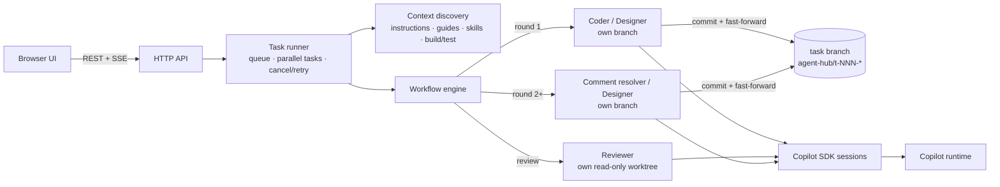

# Copilot Agent Hub

A local web service that runs **teams of sub-agents** on your repositories with the
[GitHub Copilot SDK](https://docs.github.com/en/copilot/how-tos/copilot-sdk), iterating author ↔ reviewer
until the reviewer approves.

| Task type | Sub-agents |
| --- | --- |
| **Coding** | **Coder** implements the request · **Code reviewer** reviews each commit · **Comment resolver** fixes review comments (same model as the coder by default) |
| **Design** | **Designer** writes the design document and revises it · **Design reviewer** critiques it until a finalized version is approved |
| **Design → Coding** | Designer + design reviewer finalize the design, then coder + code reviewer + comment resolver implement it |

Every sub-agent works on **its own branch** (reviewers in their own read-only worktree pinned to the
commit under review), and every task has its own branches and worktrees, so **several tasks can run on
the same repository at the same time** without touching your checkout. Agents use the repository's own
guidance (instruction files, guides, design docs, skills, build/test commands) and fall back to the hub's
best-practice skills for coding, code review and system design.

You sign in with GitHub in the browser, choose the LLMs, register repositories or folders, submit tasks,
and watch each one live: which agent is working, what it is doing right now (coding, reviewing,
resolving comments), its latest message, streaming output and tool calls; when it finishes, the result.

## Quick start

Requirements: Node.js **22.18+** (the TypeScript sources run directly), `git` on `PATH`, and a GitHub
Copilot subscription. The SDK ships its own Copilot runtime, so no separate CLI install is needed.

```powershell
npm install
npm start            # http://localhost:4600
```

1. **Sign in**: click **Sign in with GitHub** and approve access in the GitHub tab that opens.
   Approve right away; the runtime only waits a limited time.
2. **Choose models**: pick the author model (designer/coder) and the reviewer model. Using a different
   model for reviews gives a genuine second opinion. The comment resolver uses the author model unless
   you pick another one in Settings.
3. **Repositories**: register a local git repository, clone one from a URL, or register a plain folder
   and opt in to "initialize git" (git init + an initial commit of its current files).
4. **New task**: choose the type, repository, base branch and description, and optionally per-task
   models and the maximum number of review rounds.

## How a task runs



1. **Context**: at the task's base commit the hub looks for instruction files (`AGENTS.md`,
   `.github/copilot-instructions.md`, `.github/instructions/*.instructions.md`, `CLAUDE.md`), guides
   (`CONTRIBUTING.md`, `ARCHITECTURE.md`, `README.md`, …), design docs/ADRs, repository skills
   (`.github/skills`, `.copilot/skills`, `.claude/skills`, `skills`) and build/test commands (package
   scripts, .NET, Go, Rust, Python, Maven/Gradle, Makefile). Instruction files are loaded by the runtime
   automatically; the rest is listed in each agent's first prompt, and repository skills are passed to
   every agent. See the **Context** tab of a task.
2. **Author turn**: the coder (round 1), the comment resolver (rounds with open code comments) or the
   designer works on its own branch and finishes by calling the `submit_work` tool with a summary, the
   validation it ran, and a response (`addressed` or `declined` plus a note) for **every** open comment ID.
   Submissions that skip a comment are rejected so the agent must fix them.
3. **Commit**: the hub commits the agent's work on the agent's branch and fast-forwards the task branch
   to it (one commit per round). Round commits skip repository commit hooks (`--no-verify`) so a hook
   cannot stall the loop; agents run the project's build/tests themselves, and your normal hooks still
   apply when you merge or push.
4. **Review turn**: the reviewer's own worktree is pinned (detached) to the exact commit under review. It
   gets the diff (the full diff, or the round's incremental diff on re-review) and the author's
   responses, and finishes by calling `submit_review` with a verdict (`approve` / `request_changes`) and
   comments (severity, file, line, body), which get IDs such as `C3` or `D2`. It cannot approve while
   blocker/major comments remain.
5. **Iterate**: open code comments go to the comment resolver (design comments back to the designer)
   until the reviewer approves or the round budget is used up. **Continue review loop** runs more rounds
   later in fresh sessions; **Retry** resumes failed, cancelled or interrupted tasks from the last
   completed step.
6. **Result**: the task branch, commits, diff stat and final summary, with ready-to-copy `git` commands
   to inspect and merge. Design tasks keep every document version (v1, v2, … final).

Each agent keeps one Copilot session per stage, so it remembers earlier rounds; a comment resolver that
starts fresh gets the request, the previous summary and the diff so far. If an agent ends a turn
without calling its submit tool, the hub nudges it, and after two attempts derives the result from its
last message. If an agent asks a question (`ask_user`), the task shows **Needs your input**; answer in
the UI, or after the configured timeout the agent proceeds on its own judgment.

## Agents, branches and worktrees

| What | Where |
| --- | --- |
| Task branch (the result you merge) | `agent-hub/<task>-<slug>`, fast-forwarded after every author round |
| Author agents' own branches | `agent-hub/<task>-<slug>--coder`, `--resolver`, `--designer` |
| Author worktree | `data/worktrees/<task>/author` (authors switch to their own branch for their turn, so installed dependencies and build output are reused) |
| Reviewer worktree | `data/worktrees/<task>/review`, detached at the commit under review |

Set **Agent isolation** to "own worktree and branch per agent" to give every sub-agent its own worktree
(`data/worktrees/<task>/<role>`) at the cost of more disk and per-agent dependency installs. Tasks never
share worktrees, so up to **Parallel tasks** tasks run at once, including on the same repository; git
worktree operations on a repository are serialized. When a task completes, its worktrees are removed
(branches are kept) unless you turn **Cleanup** off; failed or cancelled tasks keep their worktrees for
inspection or retry. Don't check out a task branch elsewhere while its task is running.

## Best-practice skills

The hub bundles skills in [`skills/`](skills) that apply when a repository has no guidance of its own;
repository instructions and skills always take precedence:

| Skill | Used by |
| --- | --- |
| `coding-best-practices` | Coder, comment resolver |
| `review-comment-resolution` | Comment resolver |
| `code-review` | Code reviewer |
| `system-design` | Designer |
| `design-review` | Design reviewer |

Each agent is asked to load its role's skills at the start; hub skills that don't belong to the role are
disabled for its session. Edit the `SKILL.md` files to tune your team's standards.

## Sign-in options

| Option | How |
| --- | --- |
| GitHub.com (browser OAuth) | **Sign in with GitHub**. The Copilot runtime runs the OAuth flow with a local callback. |
| GitHub Enterprise Cloud | **Sign in to GitHub Enterprise Cloud (*.ghe.com)**, then enter your host. |
| Token | **Use a token instead**: a fine-grained PAT with the *Copilot Requests* permission, or an OAuth token such as `gh auth token`. Classic `ghp_` tokens are not supported. |

The hub runs its runtime with its own Copilot home (`data/copilot-home`), so its sessions, settings and
sign-in are separate from `~/.copilot`. Credentials are stored by the runtime in the OS credential
store. After a successful sign-in the hub restarts its runtime to load the new credential.

## Safety model

- **Read-only reviewers**: file writes are rejected. Shell commands are limited to read-only tools and
  read-only git subcommands (`diff`, `log`, `show`, `status`, …).
- **Authors** may write only inside their own worktree. `git push`, branch switching (`checkout <branch>`,
  `switch`), `rebase`, `reset --hard`, worktree/remote changes and global git config are rejected.
  Reads outside the worktree and persistent memory are denied. Each agent may still use its own
  session scratch folder under `<copilot home>/session-state` (for example for plans) and read the
  skill folders it was given.
- These are guardrails enforced through the SDK permission callback, **not a sandbox**: author agents
  run build/test commands on your machine with your user account. Only register repositories you are
  comfortable letting an agent work on.
- The server binds to `127.0.0.1` and checks the `Host` header (DNS-rebinding protection) and the
  `Origin` + JSON `Content-Type` of mutating requests (CSRF protection). It has no login of its own, so
  don't expose it beyond localhost.

## Configuration

Environment variables:

| Variable | Default | Purpose |
| --- | --- | --- |
| `HUB_PORT` | `4600` | HTTP port |
| `HUB_HOST` | `127.0.0.1` | Bind address (keep it on loopback) |
| `HUB_DATA_DIR` | `./data` | State, events, worktrees, clones |
| `HUB_COPILOT_HOME` | `<data>/copilot-home` | Copilot runtime home (sessions, sign-in) |
| `HUB_RUNTIME_LOG_LEVEL` | `error` | Copilot runtime log level |

Settings page: default author, comment-resolver and reviewer models, agent isolation (own branch per
agent, or own worktree per agent), worktree cleanup on completion, max review rounds (default 3),
parallel tasks (default 2), design document folder (default `docs/designs`), agent turn timeout, and
question timeout.

## Data layout

```text
data/
  state.json                 settings, repositories, tasks (with per-agent state and discovered context)
  tasks/<id>/events.jsonl    timeline (append-only)
  tasks/<id>/design-rN.md    design document snapshot for round N
  worktrees/<id>/author/     author agents' worktree (or <id>/<role>/ with per-agent worktrees)
  worktrees/<id>/review/     reviewer worktree, detached at the reviewed commit
  repos/                     repositories cloned from a URL
  copilot-home/              Copilot runtime home
```

Deleting a task removes its worktrees, agent branches, history and agent sessions; optionally it also
deletes the task branch.

## HTTP API

| Method & path | Purpose |
| --- | --- |
| `GET /api/auth` · `POST /api/auth/login` · `POST /api/auth/login/:flow/input` · `POST /api/auth/login/:flow/cancel` · `POST /api/auth/token` · `POST /api/auth/logout` | Sign-in state and flows |
| `GET /api/models` | Models available to the signed-in account |
| `GET/PUT /api/settings` | Settings |
| `GET/POST /api/repos` · `DELETE /api/repos/:id` · `GET /api/repos/:id/branches` | Repository registry |
| `GET/POST /api/tasks` · `GET/DELETE /api/tasks/:id` | Tasks |
| `POST /api/tasks/:id/cancel` · `POST /api/tasks/:id/retry` · `POST /api/tasks/:id/input` | Control and answers |
| `GET /api/tasks/:id/diff?from=&to=` · `GET /api/tasks/:id/design?round=` | Changes and design versions |
| `GET /api/stream` · `GET /api/tasks/:id/stream?after=<seq>` | Server-Sent Events (global / per task) |

Mutating requests must send `Content-Type: application/json`.

## Development

```powershell
npm test             # node:test – workflow engine (scripted agents + real git), concurrency, context, policy
npm run typecheck    # tsc for src and tests
npm run dev          # restart on file changes
```

```text
src/
  main.ts                 wiring and graceful shutdown
  copilot/service.ts      CopilotClient lifecycle, sign-in flows, model catalog
  agents/                 driver interface, Copilot SDK driver, prompts, submit tools, permission policy
  workflow/               runner (queue, workspaces, questions), engine (sub-agent loop), validation
  http/                   dependency-free router, SSE, API routes
  context.ts              repository context discovery and hub skills
  git.ts                  task/agent workspaces: branches, worktrees, fast-forward, diffs
  store.ts repos.ts
skills/                   bundled best-practice skills (SKILL.md)
public/                   no-build UI (ES modules): sign-in, models, tasks, task detail, repos, settings
test/                     node:test suites
```
