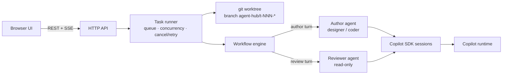

# Copilot Agent Hub

A local web service that runs **author ↔ reviewer agent loops** on your repositories with the
[GitHub Copilot SDK](https://docs.github.com/en/copilot/how-tos/copilot-sdk).

- **Coding tasks**: a coder agent implements the request and a code-reviewer agent reviews the diff.
  Review comments go back to the coder round by round until the reviewer approves.
- **Design tasks**: a designer agent writes a design document and a design-reviewer critiques it.
  The designer revises it into a finalized, reviewed version.
- **Design → Coding**: a design is finalized first, then implemented with the coding loop.

You sign in with GitHub in the browser, choose the LLMs for author and reviewer agents, register
repositories, submit tasks, and watch each task live: phase (coding, reviewing, addressing comments),
round, current tool call, streaming agent output, review threads, design versions and diffs.

## Quick start

Requirements: Node.js **22.18+** (the TypeScript sources run directly), `git` on `PATH`, and a GitHub
Copilot subscription. The SDK ships its own Copilot runtime, so no separate CLI install is needed.

```powershell
npm install
npm start            # http://localhost:4600
```

1. **Sign in**: click **Sign in with GitHub** and approve access in the GitHub tab that opens.
   Approve right away; the runtime only waits a limited time.
2. **Choose models**: pick the author model (designer/coder) and the reviewer model. Using a different
   model for reviews gives a genuine second opinion.
3. **Repositories**: register a local git repository path, or clone one from a URL.
4. **New task**: choose the type, repository, base branch and description, and optionally per-task
   models and the maximum number of review rounds.

## How a task runs



1. **Isolation**: each task gets a dedicated git worktree under `data/worktrees/<task>` on a new branch
   `agent-hub/<task>-<slug>`, created from the base branch. Your own checkout is never modified.
2. **Author turn**: the author agent works and finishes by calling the `submit_work` tool with a summary,
   the validation it ran, and a response (`addressed` or `declined` plus a note) for **every** open
   comment ID. Submissions that skip a comment are rejected so the agent must fix them.
3. **Commit**: the hub commits the worktree after each author round (one commit per round). Round
   commits skip repository commit hooks (`--no-verify`) so a hook cannot stall the loop; agents run the
   project's build/tests themselves, and your normal hooks still apply when you merge or push.
4. **Review turn**: the reviewer gets the diff (the full diff, or the round's incremental diff on
   re-review) and the author's responses. It finishes by calling `submit_review` with a verdict
   (`approve` / `request_changes`) and comments (severity, file, line, body), which get IDs such as `C3`
   or `D2`. It cannot approve while blocker/major comments remain.
5. **Iterate**: open comments go back to the author until the reviewer approves or the round budget is
   used up. **Continue review loop** runs more rounds later in fresh sessions; **Retry** resumes failed,
   cancelled or interrupted tasks from the last completed step.
6. **Result**: the branch, commits, diff stat and final summary, with ready-to-copy `git` commands to
   inspect and merge. Design tasks keep every document version (v1, v2, … final).

Both agents keep one Copilot session per stage, so they remember earlier rounds. If an agent ends a
turn without calling its submit tool, the hub nudges it, and after two attempts derives the result
from its last message. If an agent asks a question (`ask_user`), the task shows **Needs your input**;
answer in the UI, or after the configured timeout the agent proceeds on its own judgment.

## Sign-in options

| Option | How |
| --- | --- |
| GitHub.com (browser OAuth) | **Sign in with GitHub**. The Copilot runtime runs the OAuth flow with a local callback. |
| GitHub Enterprise Cloud | **Sign in to GitHub Enterprise Cloud (*.ghe.com)**, then enter your host. |
| Token | **Use a token instead**: a fine-grained PAT with the *Copilot Requests* permission, or an OAuth token such as `gh auth token`. Classic `ghp_` tokens are not supported. |

The hub runs its runtime with its own Copilot home (`data/copilot-home`), so its sessions, settings and
sign-in are separate from `~/.copilot`. Credentials are stored by the runtime in the OS credential
store. After a successful sign-in the hub restarts its runtime to load the new credential.

## Safety model

- **Read-only reviewers**: file writes are rejected. Shell commands are limited to read-only tools and
  read-only git subcommands (`diff`, `log`, `show`, `status`, …).
- **Authors** may write only inside the task worktree. `git push`, branch switching (`checkout <branch>`,
  `switch`), `rebase`, `reset --hard`, worktree/remote changes and global git config are rejected.
  Reads outside the worktree and persistent memory are denied. Each agent may still use its own
  session scratch folder under `<copilot home>/session-state` (for example for plans).
- These are guardrails enforced through the SDK permission callback, **not a sandbox**: author agents
  run build/test commands on your machine with your user account. Only register repositories you are
  comfortable letting an agent work on.
- The server binds to `127.0.0.1` and checks the `Host` header (DNS-rebinding protection) and the
  `Origin` + JSON `Content-Type` of mutating requests (CSRF protection). It has no login of its own, so
  don't expose it beyond localhost.

## Configuration

Environment variables:

| Variable | Default | Purpose |
| --- | --- | --- |
| `HUB_PORT` | `4600` | HTTP port |
| `HUB_HOST` | `127.0.0.1` | Bind address (keep it on loopback) |
| `HUB_DATA_DIR` | `./data` | State, events, worktrees, clones |
| `HUB_COPILOT_HOME` | `<data>/copilot-home` | Copilot runtime home (sessions, sign-in) |
| `HUB_RUNTIME_LOG_LEVEL` | `error` | Copilot runtime log level |

Settings page: default author/reviewer models, max review rounds (default 3), parallel tasks
(default 2), design document folder (default `docs/designs`), agent turn timeout, and question timeout.

## Data layout

```text
data/
  state.json                 settings, repositories, tasks
  tasks/<id>/events.jsonl    timeline (append-only)
  tasks/<id>/design-rN.md    design document snapshot for round N
  worktrees/<id>/            task worktree (removed when the task is deleted)
  repos/                     repositories cloned from a URL
  copilot-home/              Copilot runtime home
```

Deleting a task removes its worktree, history and agent sessions; optionally it also deletes the branch.

## HTTP API

| Method & path | Purpose |
| --- | --- |
| `GET /api/auth` · `POST /api/auth/login` · `POST /api/auth/login/:flow/input` · `POST /api/auth/login/:flow/cancel` · `POST /api/auth/token` · `POST /api/auth/logout` | Sign-in state and flows |
| `GET /api/models` | Models available to the signed-in account |
| `GET/PUT /api/settings` | Settings |
| `GET/POST /api/repos` · `DELETE /api/repos/:id` · `GET /api/repos/:id/branches` | Repository registry |
| `GET/POST /api/tasks` · `GET/DELETE /api/tasks/:id` | Tasks |
| `POST /api/tasks/:id/cancel` · `POST /api/tasks/:id/retry` · `POST /api/tasks/:id/input` | Control and answers |
| `GET /api/tasks/:id/diff?from=&to=` · `GET /api/tasks/:id/design?round=` | Changes and design versions |
| `GET /api/stream` · `GET /api/tasks/:id/stream?after=<seq>` | Server-Sent Events (global / per task) |

Mutating requests must send `Content-Type: application/json`.

## Development

```powershell
npm test             # node:test – workflow engine (scripted agents + real git), policy, validation
npm run typecheck    # tsc for src and tests
npm run dev          # restart on file changes
```

```text
src/
  main.ts                 wiring and graceful shutdown
  copilot/service.ts      CopilotClient lifecycle, sign-in flows, model catalog
  agents/                 driver interface, Copilot SDK driver, prompts, submit tools, permission policy
  workflow/               runner (queue, worktrees, questions), engine (author/reviewer loop), validation
  http/                   dependency-free router, SSE, API routes
  git.ts store.ts repos.ts
public/                   no-build UI (ES modules): views for sign-in, models, tasks, task detail, repos, settings
test/                     node:test suites
```
