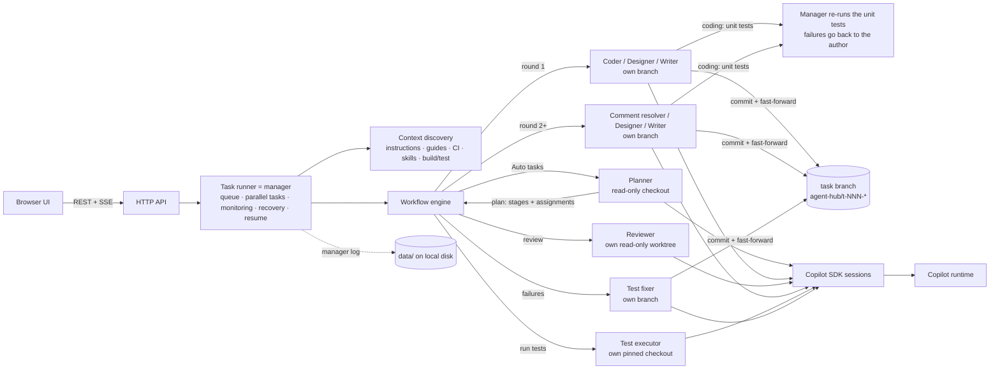

# Copilot Agent Hub

A local web service that runs **teams of sub-agents** on your repositories with the
[GitHub Copilot SDK](https://docs.github.com/en/copilot/how-tos/copilot-sdk). A **manager agent** reads your
request, decides which sub-agents to create, assigns their work and monitors them, and recovers agents that
get stuck; the sub-agents iterate author ↔ reviewer (or execute ↔ fix) until the work is approved or the
tests pass.

| Task type | Sub-agents |
| --- | --- |
| **Auto** (default) | The **manager's planner** reads the request and the repository, picks the stages below (for example *Coding → Execute & verify*), writes each team's assignment, and the hub creates those sub-agents |
| **Coding** | **Coder** implements the request with unit tests and gets them passing · the **manager re-runs the unit tests** and only then hands the round to the **Code reviewer** · the **Comment resolver** fixes review comments (same model as the coder by default) and gets the unit tests passing again before the next review, until the reviewer approves |
| **Execute & verify** | **Test executor** runs the test automation and verifies the results · **Test fixer** fixes failures at the root cause · the executor re-runs and checks the fixes are legitimate, until everything passes |
| **Design** | **Designer** writes the design document and revises it · **Design reviewer** critiques it until a finalized version is approved |
| **Document** | **Technical writer** writes documentation grounded in the repository (several documents when the request calls for them) · **Doc reviewer** checks accuracy and clarity until it is approved |
| **Design → Coding** | Designer + design reviewer finalize the design, then coder + code reviewer + comment resolver implement it |
| **Code review** | Reviews someone else's change - a **pull request** (number or URL) or a **branch** - with two reviewers, usually on different models: the **Lead reviewer** and the **Peer reviewer** review independently, respond to each other's findings, then the lead writes the final review and the peer signs off. You keep, drop or edit each comment and **publish** them on the pull request with one click (see [Code review](#code-review-two-reviewers-then-you-publish)) |

Every sub-agent works on **its own branch** (reviewers and the test executor in their own worktree pinned
to the commit under review/test), and every task has its own branches and worktrees, so **several tasks
can run on the same repository at the same time** without touching your checkout. Every sub-agent starts
with the repository's context already set up: its own guidance (instruction files, guides, CI pipelines,
design docs, skills, build/test commands), the manager's briefing on the repository (Auto tasks), and the
hub's best-practice skills for its role and for the technologies the repository uses (TypeScript/Node.js,
.NET, Python, Go, Rust, Java/Kotlin, PowerShell, C/C++). Design and document deliverables are
**light-themed HTML pages** with Mermaid diagrams, rendered in the UI.

You sign in with GitHub in the browser, choose the LLMs, register repositories or folders, submit tasks,
and watch each one live: which agent is working, what it is doing right now (planning, coding, reviewing,
running tests, fixing failures), its latest message, streaming output and tool calls; when it finishes,
the result. The **Agents** page shows the same work from the agents' side: a live hierarchy (or pipeline)
of the manager, the tasks and their sub-agents, and the manager's conversation with them. Everything
(settings, repositories, each task's last state and history) is saved on local disk and survives restarts.

## Quick start

Requirements: Node.js **22.18+** (the TypeScript sources run directly), `git` on `PATH`, and a GitHub
Copilot subscription. The SDK ships its own Copilot runtime, so no separate CLI install is needed.

```powershell
cd agent-hub         # this folder of the WindowsVMAgent repository
npm install
npm start            # http://localhost:4600
```

1. **Sign in**: click **Sign in with GitHub** and approve access in the GitHub tab that opens.
   Approve right away; the runtime only waits a limited time.
2. **Choose models**: pick the author model (designer/writer/coder) and the reviewer model. Using a different
   model for reviews gives a genuine second opinion. The comment resolver / test fixer and the manager
   use the author model unless you pick others in Settings.
3. **Repositories**: register a local git repository, clone one from a URL, or register a plain folder
   and opt in to "initialize git" (git init + an initial commit of its current files).
4. **New task**: keep **Auto** to let the manager decide which agents to create, or choose a type; pick the
   repository, base branch and description, and optionally per-task models and the maximum number of
   review rounds / test runs.

## How a task runs



0. **Plan** (Auto tasks): the manager's planner inspects the repository read-only and calls `submit_plan`
   with the stages to run (design, coding, testing, document; they always run in that order), its
   rationale, an assignment for each stage's team (scope, acceptance criteria, the exact test commands)
   and a **briefing** on the repository (relevant modules and files, conventions, verified build/test
   commands, pitfalls). The hub creates the corresponding sub-agents and gives each the briefing and its
   assignment, so no agent has to rediscover the repository. If the planner does not submit a plan, the
   hub derives the stages from keywords in the request.
1. **Context**: at the task's base commit the hub looks for instruction files (`AGENTS.md`,
   `.github/copilot-instructions.md`, `.github/instructions/*.instructions.md`, `CLAUDE.md`, and
   `AGENTS.md` files in subfolders), guides (`CONTRIBUTING.md`, `ARCHITECTURE.md`, `TESTING.md`,
   `README.md`, CI pipelines, …), design docs/ADRs, repository skills (`.github/skills`,
   `.copilot/skills`, `.claude/skills`, `skills`), the technologies in use and build/test commands
   (package scripts, .NET, Go, Rust, Python, Maven/Gradle, CMake, Makefile, Pester). Root instruction
   files are loaded by the runtime automatically; the rest is listed in each agent's first prompt (agents
   are told to read folder-level instructions themselves), repository skills are passed to every agent,
   and the agents that design, write, review or test code also get the hub's
   [best-practice skill](#best-practice-skills) for each detected technology. See the **Context** tab of
   a task.
2. **Author turn**: the coder (round 1), the comment resolver (rounds with open code comments), the
   designer or the technical writer works on its own branch and finishes by calling the `submit_work`
   tool with a summary, the validation it ran, and a response (`addressed` or `declined` plus a note) for
   **every** open comment ID. Submissions that skip a comment are rejected so the agent must fix them.
3. **Unit tests** (coding rounds): the coder and the comment resolver write or update unit tests for
   their change and run the tests that cover it until they pass; `submit_work` must report them
   (`unit_tests`: status and the exact commands), and a report of failing tests is rejected until they are
   fixed. Agents stay within the request (no refactoring or reformatting of unrelated code, no edits to
   unrelated tests), and a failing test the change has nothing to do with - it fails without the change
   too, or it is flaky, in code the change doesn't touch - is **left for its owners**: the agent lists it
   under `unrelated_failures` and reports commands that cover its change without it, reviewers don't ask
   for it to be fixed (unless the change actually causes it), and the pull request description names it.
   The manager then **re-runs those commands itself** in the author's worktree (in the agent's shell, non-interactively,
   one task at a time per repository, stopping a run that goes silent). A command that fails is run once
   more from a clean state: if it passes, it is a flaky test, noted for the reviewer and not sent back.
   Any other failure - the command, its exit code and the end of its output - goes back to the same agent,
   up to 3 times, so the reviewer only gets rounds whose unit tests pass. Files the manager's run creates
   or changes are discarded so they never land in the commit.
   If the tests still fail, the round goes to review flagged and the reviewer **cannot approve** it; if
   the author reports them as *blocked* (a missing tool or service), the reviewer weighs the reason. The
   **Rounds** tab shows each round's unit tests.
4. **Commit**: the hub commits the agent's work on the agent's branch and fast-forwards the task branch
   to it (one commit per round). Round commits skip repository commit hooks (`--no-verify`) so a hook
   cannot stall the loop; agents run the project's build/tests themselves, and your normal hooks still
   apply when you merge or push.
5. **Review turn**: the reviewer's own worktree is pinned (detached) to the exact commit under review. It
   gets the diff (the full diff, or the round's incremental diff on re-review), the author's responses
   and, for code, the manager's unit-test result, and finishes by calling `submit_review` with a verdict
   (`approve` / `request_changes`) and comments (severity, file, line, body), which get IDs such as `C3`
   (code), `D2` (design) or `W1` (document). It cannot approve while blocker/major comments remain.
6. **Iterate**: open code comments go to the comment resolver (design and document comments back to
   their author), whose fixes are tested again before the next review, until the reviewer approves or the
   round budget is used up. **Continue review loop** runs more rounds later in fresh sessions; **Retry**
   resumes failed, cancelled or interrupted tasks from the last completed step.
7. **Result**: the task branch, commits, diff stat, unit and test results and final summary (one section
   per stage), with ready-to-copy `git` commands to inspect and merge. Design and document tasks keep
   every document version (v1, v2, … final).
8. **Push & pull request**: the hub pushes the task branch to the repository's remote and the task gets a
   **Create pull request** button (see [Pushing branches and pull requests](#pushing-branches-and-pull-requests)).
9. **Request changes**: once finished (approved or not) you can ask for further changes or adjustments,
   as often as you like (see [Requesting changes after a task finishes](#requesting-changes-after-a-task-finishes)).

Each agent keeps one Copilot session per stage, so it remembers earlier rounds; a comment resolver or test
fixer that starts fresh gets the request, the previous summary and the diff so far. If an agent ends a turn
without calling its submit tool, the hub nudges it, and after two attempts derives the result from its
last message (a test run without structured results counts as *blocked*, never as passed). If an agent
asks a question (`ask_user`), the task shows **Needs your input**; answer in the UI, or after the
configured timeout the agent proceeds on its own judgment. Agents that get stuck are recovered by the
manager (see [Monitoring and recovering stuck agents](#monitoring-and-recovering-stuck-agents)).

## Requesting changes after a task finishes

Every finished task, approved or not, has a **✎ Request changes** button (title bar, result card and
Result tab). Describe what should change, optionally pick the stage it applies to (default: the last one)
and the round budget:

- The request becomes change request **U1** (then U2, …): a round of its own, shown as *Your change
  request* in the Rounds tab and the pipelines. The stage's author makes the change on its own branch,
  on top of the latest result: the comment resolver for code, the designer or technical writer for
  documents, the test fixer for tests. It must answer U1 with *addressed* or *declined* (with a reason).
- The stage's reviewer verifies that the request was carried out (a decline is accepted only when the
  request is impossible or harmful), or the test executor re-runs the tests. They iterate as usual until
  approved or the rounds run out. Your requests take priority over earlier review preferences.
- Later stages are brought in line: after a design change the code is updated to match, and after a code
  change the test executor re-runs the tests. Earlier stages are left as they are.
- The task then completes again and its branch is pushed, so an open pull request picks up the change.
  The Result tab lists every change request with its status and the agent's response.

## Code review: two reviewers, then you publish

A **Code review** task reviews a change someone else wrote; it changes no code. Enter what to review:

- a **pull request**: `#12`, `12`, `PR 12`, `!12` (GitLab) or its URL. The hub fetches its head from the
  repository's remote that hosts it (`refs/pull/N/head` on GitHub and GitHub-like hosts,
  `refs/merge-requests/N/head` on GitLab, `refs/pull/N/merge` on Azure DevOps; Bitbucket does not expose
  pull requests to git, so review the source branch there) and fetches its target branch. URLs also match
  remotes on custom domains and SSH host aliases. With the GitHub CLI signed in to the host (github.com,
  GitHub Enterprise Cloud, or GitHub Enterprise Server on its own domain), the hub also reads the pull
  request's title, description, author and target branch;
- or a **branch, tag or commit** (`feature/login`, `origin/feature/login`), compared with the target branch
  you pick (the repository's default branch by default). On GitHub, a branch with an open pull request is
  reviewed like that pull request - against its target branch - and its review can be published there.

The review covers `merge-base(target, head)..head`, the same change the pull request shows, and the hub
keeps the reviewed head on a local branch `agent-hub/<task>-<title>` (never pushed). The optional focus
tells the reviewers what to look at.

1. **Independent reviews** (round 1, both reviewers in parallel, each in its own read-only worktree at the
   head): each one reads the change, its context and the repository's guidance and calls
   `submit_findings` with a summary of what the change does, an assessment, a verdict and comments
   anchored to file and line (`L1`, `L2`, … for the lead; `P1`, `P2`, … for the peer).
2. **Discussion** (round 2, in parallel): each reviewer responds to every comment of the other -
   *agree*, *disagree* with evidence, or *refine* (better text, severity or line) - withdraws or revises its
   own comments, and may add issues both missed (`submit_positions`).
3. **Final review**: the lead merges duplicates, applies agreed refinements, decides disputed comments
   and writes the final summary, assessment, verdict and comments `R1`, `R2`, …; every reviewer comment
   must end up in a final comment or be dropped with a reason (`submit_final_review`).
4. **Sign-off**: the peer accepts the final review or objects (`submit_signoff`). The lead revises for the
   objections and the peer checks again, for up to the task's **Max final-review rounds** (default 3);
   remaining objections are shown to you on the comments they concern.

The **Review** tab then shows the **summary of the change** (what it does, files with line counts, the
reviewers' assessment and whether both agree) and the **comments**, each with **Keep / Drop**, **✎ Update**
(edit its text and severity; *Undo edit* restores the reviewers' version) and who raised it. Comments
the final review left out (dropped or withdrawn) are listed with the reason and an **+ Add to review**
button. Edit the review text and pick how to submit it (*Comment*, *Request changes*, *Approve*), then:

- **Publish comments to pull request #N** (GitHub, with the GitHub CLI signed in to the host:
  `gh auth login`) posts one review: comments on lines of the diff become inline comments, the others go
  into the review's text. Nothing is posted until you click it. If GitHub rejects a line, every comment
  goes into the review's text instead.
- After publishing, keep curating: **Publish updates** applies your changes to the pull request - edited
  comments are edited there, dropped ones deleted, new ones added in a follow-up review, and the review's
  text updated - so the pull request always shows the latest version without duplicates. (If GitHub
  created the review but the hub could not read back its comments' IDs, later edits of those comments are
  made on GitHub; the hub says so and never posts the review twice.)
- **Copy as Markdown** copies the whole review for hosts the hub can't publish to (Azure DevOps, GitLab,
  Bitbucket) or for a branch without a pull request.

The **Discussion** tab shows every round: each reviewer's findings, their stances on each other's
comments, the final review with what was dropped and why, and the sign-offs. Both reviewers are monitored
and recovered like any agent, a failed or cancelled review resumes from the last finished step on
**Retry**, and code review tasks are never pushed. The lead reviewer uses the reviewer model, the peer
reviewer the **Peer reviewer model** (Settings or the New task form; default: the author model); pick two
different models for a real second opinion.

## Execute & verify: running test automation

The testing stage (the **Execute & verify** task type, or chosen by the manager for Auto tasks) loops
between two agents:

1. **Test executor** — works in its own checkout pinned to the commit under test, may run any setup,
   build and test command (installing dependencies is fine) but may not edit files or move git state. It
   finds the right commands (the request and the manager's assignment first, then package scripts,
   Makefiles, test projects, Pester tests, CI pipelines), runs the complete suite, and **verifies** the
   outcome instead of trusting exit codes: zero tests discovered is a failure, skipped tests are noted,
   suspected flaky tests are re-run. It reports through `submit_test_results`: status (`passed`,
   `failed`, `blocked`), the exact commands, counts, an output excerpt, and one entry per failure with
   the error and a triage category — `product-bug`, `test-bug`, `environment`, `flaky` or `integrity` —
   plus a suggested fix. Failures get IDs `T1`, `T2`, … Failures the requested change has nothing to do
   with (they fail without it too, or are flaky, in code the change doesn't touch) are reported separately
   as *unrelated failures*: they show in the run and the pull request description, never go to the fixer
   and don't keep the stage from passing. When the request itself is to run and fix the tests, every
   failure in the requested tests counts.
2. **Test fixer** — on its own branch, fixes each listed failure at its root cause (the product code when
   its behavior is wrong, the test only when the test itself is wrong, with a justification) without
   touching unrelated code or tests, re-runs the failing tests, and responds to every failure ID
   (`addressed`, or `declined` with what is needed, for example a missing tool or credential).
3. **Verification** — the executor re-runs the **complete** suite at the fixer's commit and inspects the
   fixer's diff: deleted or skipped tests, weakened assertions, swallowed errors or hard-coded results are
   reported as `integrity` failures. The stage passes when everything requested ran and no failure related
   to the request remains.

If the fixer declines every failure without changing anything, the stage stops instead of re-running
unchanged code. **Continue fixing** runs more fix-and-verify rounds later (for example after you install
a missing tool).

## Agents view: the manager and its sub-agents

The **Agents** page shows the work from the agents' side, updated live over Server-Sent Events:

- **Stats**: whether the manager is online, running/queued tasks against the parallel-task capacity
  (with a live **Limit − / +** control), how many sub-agents are working or waiting for their turn, and
  recent message volume.
- **Hierarchy** diagram: *You → Manager agent → tasks → sub-agents*. For Auto tasks the manager's
  **planner** appears first under the task, followed by the agents it decided to create. Each agent
  node shows its model, status, what it is doing now, its last instruction from (↓) or report to (↑) the
  manager, and a heartbeat (♥). Active links animate, and every message travels along the edges as a
  colored pulse (plans, manager → agent assignments, agent → manager submissions, verdicts and test
  results). Click a node to open the task.
- **Pipeline** mode: one row per task with its stage lanes (author → reviewer ↺ comment resolver;
  test executor ↺ test fixer), the current step highlighted and each round's outcome.
- **Manager ↔ agents** feed: every message the manager exchanges — plans, session starts, assignments,
  submissions, review requests, verdicts, test results, nudges, monitoring check-ins, recoveries,
  questions/answers and releases — filterable by task.
- **Sub-agents by role**: how many agents of each role are working, waiting or done, and which tasks
  each is handling.

## Monitoring and recovering stuck agents

The manager watches every working agent's **heartbeat**: any session event counts as a sign of life
(streamed text and reasoning, tool calls, live shell output, its own sub-agents), as does the start of a
turn or your answer to its question. Every minute it checks each working agent:

- **Check-in**: after 5 minutes without a sign of life it posts a check-in to the feed.
- **Stuck** (Settings → **Recover a stuck agent after**, default 15 minutes without a sign of life), a
  turn that runs past the **agent turn timeout**, or a session that fails (for example a lost
  connection) is recovered step by step:
  1. **Interrupt and continue**: the manager aborts the stuck turn and tells the agent, in the same
     session, what got stuck and to carry on without repeating it (timeouts, non-interactive flags, no
     foreground servers or watchers, narrow a hanging run). The agent keeps its conversation and its work.
  2. **Kill and restart**: if that does not help, or the session itself failed, the manager kills the
     session and starts a fresh one for the same role with the **full assignment** (request, repository
     context, briefing, round instructions) plus a note to build on the uncommitted changes the stuck
     session left in the worktree. If the Copilot runtime itself stopped answering, the hub restarts the
     runtime first.
  3. **Give up**: after 3 recoveries in one turn the task fails with the reason; **Retry** resumes it from
     the last completed step (uncommitted work in the author worktree is kept).

  An agent that already submitted its result before it went quiet is not re-prompted; the workflow just
  moves on. Recoveries appear in the feed (*recovery*), the task timeline and each agent card
  ("recovered N×"). Agents are also told up front that they are monitored and to run commands
  non-interactively and with timeouts, which prevents most hangs.

## Design and document deliverables (HTML)

Design and document tasks produce a self-contained, **light-themed HTML page** (Settings → Documents
→ Format; Markdown is also available). Before round 1 the hub seeds the file from
[`templates/`](templates): a polished page with callouts, cards, tables, numbered steps and Mermaid
diagram blocks whose sections carry `data-placeholder` markers. The author fills it in, and the hub
rejects a submission while the template is unchanged, placeholders remain, or the title is missing.

The **Document** tab renders every version in a sandboxed iframe (no access to the hub UI or API; only
the hub's local Mermaid copy may run) with a Rendered / HTML source toggle and an **Open ↗** link. The
committed file includes a small Mermaid loader so diagrams also render when the file is opened directly.
Designs go to `docs/designs/` and documents to `docs/` by default (both configurable).

When a request calls for several documents (for example a guide per component, or a runbook plus an
FAQ), the technical writer makes the configured file the main document and writes each further document
next to it, linked from the main one; the doc reviewer reviews all of them. The tab then becomes
**Documents (N)**: a list of every document the task wrote (deliverables first, with their stage and number
of versions); click one to view it, version by version. Further HTML documents are rejected while they
still contain template placeholders.

## Agents, branches and worktrees

| What | Where |
| --- | --- |
| Task branch (the result you merge) | `agent-hub/<task>-<slug>`, fast-forwarded after every author round |
| Author agents' own branches | `agent-hub/<task>-<slug>--coder`, `--resolver`, `--designer`, `--writer`, `--fixer` |
| Author worktree | `data/worktrees/<task>/author` (authors switch to their own branch for their turn, so installed dependencies and build output are reused) |
| Reviewer / planner worktree | `data/worktrees/<task>/review`, detached at the commit under review (the base commit for the planner) |
| Test executor worktree | `data/worktrees/<task>/run`, detached at the commit under test; kept across runs so installed dependencies and build output are reused |
| Code review tasks | lead reviewer in `data/worktrees/<task>/review`, peer reviewer in `data/worktrees/<task>/review-peer`, both detached at the reviewed head; the head is kept on the local branch `agent-hub/<task>-…` |

Set **Agent isolation** to "own worktree and branch per agent" to give every sub-agent its own worktree
(`data/worktrees/<task>/<role>`) at the cost of more disk and per-agent dependency installs. Tasks never
share worktrees, so up to **Parallel tasks** tasks (default and maximum: 10) run at once, including on the
same repository; further tasks wait in the queue and start in submission order as slots free up. Change
the limit live with the **Parallel tasks − / +** control in the Tasks page header (or the Agents page,
or Settings): raising it starts queued tasks right away; lowering it lets running tasks finish while new
ones wait. Git worktree operations on a repository are serialized. When a task completes, its worktrees
are removed (branches are kept) unless you turn **Cleanup** off; failed or cancelled tasks keep their
worktrees for inspection or retry. Don't check out a task branch elsewhere while its task is running.

Tasks running on the same repository don't affect each other's code or unit test results:

- Each task codes, builds and tests in its own worktrees on its own branches, with its own installed
  dependencies and build output.
- The manager's unit test re-runs on a repository run **one at a time**: a task whose tests are ready
  waits while another task's run finishes (its timeline says so), so tests that use a fixed port, a local
  database or another machine-wide resource don't collide.
- Each run gets the task's own temp folder (`TMP`/`TEMP`/`TMPDIR` = `data/worktrees/<task>/tmp`, emptied
  before every run), the worktree's own `.venv` and `node_modules/.bin` first on `PATH`, and no MSBuild
  nodes that outlive the build (`MSBUILDDISABLENODEREUSE=1`). Processes a run leaves behind (a test
  server, a watcher) are stopped when it ends (its process group; a job object on Windows), so they can't
  hold the next run's ports or files, and files the run creates or changes are discarded.
- Agents can't install tools or packages machine-wide or change machine settings (see
  [Safety model](#safety-model)); they are told to install project-locally, use ephemeral ports and unique
  temp paths, and stop background processes they start.
- The hub's own git commands never start automatic `gc`/maintenance, so they don't lock the repository
  that all tasks' worktrees share.

## Pushing branches and pull requests

- **Automatic push**: when a task completes, the hub pushes its task branch (only the task branch, not
  the agents' `--coder`/`--fixer`/… branches) to the repository's remote (`origin`, or the first remote)
  with your normal git credentials. It never force-pushes, pushes to one repository one at a time, and
  pushes after the task has freed its slot, so queued tasks don't wait for the network. Repositories
  without a remote, and tasks that made no changes, are skipped. A failed push shows git's error and a
  **Retry push** button. Turn automatic pushes off in Settings → Workspaces → **Push**; finished tasks
  then offer **Push branch**.
- **Create pull request** (task result card and Result tab) pushes the branch first if needed, then:
  - creates the pull request directly when the GitHub CLI is signed in to the remote's host
    (`gh auth login`): title from the task, a description built from the result (summary, request,
    manager's plan, outcome, tests, agents), as a **draft** when the task wasn't approved or tests still
    fail. The task then links to it (**Pull request #N ↗**);
  - otherwise opens the host's create page with the branches filled in: GitHub (including GitHub
    Enterprise), Azure DevOps, GitLab and Bitbucket (GitHub and GitLab also get the title and
    description).
- Pull requests target the branch the task started from, or the repository's default branch. When a
  task runs again (for example **Continue review loop**), its new commits are pushed to the same branch,
  so an open pull request updates itself.
- The task list shows **↑ pushed**, **push failed** and **PR #N** badges. The hub never reads or stores
  git or GitHub tokens: pushes use git's credential helper, pull requests the GitHub CLI's sign-in.

## Best-practice skills

The hub bundles skills in [`skills/`](skills) that apply when a repository has no guidance of its own;
repository instructions and skills always take precedence:

| Skill | Used by |
| --- | --- |
| `coding-best-practices` | Coder, comment resolver, test fixer |
| `review-comment-resolution` | Comment resolver |
| `code-review` | Code reviewer, lead reviewer, peer reviewer |
| `test-execution` | Test executor |
| `test-fixing` | Test fixer |
| `system-design` | Designer |
| `design-review` | Design reviewer |
| `technical-writing` | Technical writer |
| `doc-review` | Doc reviewer |

Technology skills apply to the agents that design, write, review or test code (designer, design reviewer,
coder, comment resolver, code reviewer, lead and peer reviewers, test executor, test fixer), one per technology the hub detects
in the repository:

| Skill | Detected from |
| --- | --- |
| `typescript-best-practices` | `package.json`, `tsconfig.json` (TypeScript, JavaScript, Node.js) |
| `dotnet-best-practices` | `*.sln`, `*.slnx`, `*.csproj`, `*.fsproj` |
| `python-best-practices` | `pyproject.toml`, `setup.py`, `requirements.txt` |
| `go-best-practices` | `go.mod` |
| `rust-best-practices` | `Cargo.toml` |
| `java-best-practices` | `pom.xml`, `build.gradle(.kts)` (Java, Kotlin) |
| `powershell-best-practices` | `*.ps1`, `*.psm1`, `*.psd1` |
| `cpp-best-practices` | `CMakeLists.txt`, `*.vcxproj` or `meson.build` with C/C++ sources |

Each agent is asked to load its skills at the start; hub skills that don't apply to it are disabled for
its session. The Context tab lists the technology skills and each agent card the skills it got. Edit the
`SKILL.md` files to tune your team's standards.

## Sign-in options

| Option | How |
| --- | --- |
| GitHub.com (browser OAuth) | **Sign in with GitHub**. The Copilot runtime runs the OAuth flow with a local callback. |
| GitHub Enterprise Cloud | **Sign in to GitHub Enterprise Cloud (*.ghe.com)**, then enter your host. |
| Token | **Use a token instead**: a fine-grained PAT with the *Copilot Requests* permission, or an OAuth token such as `gh auth token`. Classic `ghp_` tokens are not supported. |

The hub runs its runtime with its own Copilot home (`data/copilot-home`), so its sessions, settings and
sign-in are separate from `~/.copilot`. Credentials are stored by the runtime in the OS credential
store. After a successful sign-in the hub restarts its runtime to load the new credential.

## Safety model

- **Read-only reviewers and planner**: file writes are rejected. Shell commands are limited to read-only
  tools and read-only git subcommands (`diff`, `log`, `show`, `status`, …). This includes both code review
  reviewers; only the hub fetches pull requests and, when you click **Publish**, posts the review through
  the GitHub CLI.
- **Test executor**: may run any build/test command in its own pinned checkout, but file edits are
  rejected and git is limited to read-only subcommands (plus `submodule`/`lfs` to fetch test content).
- **Authors** may write only inside their own worktree. `git push`, branch switching (`checkout <branch>`,
  `switch`), `rebase`, `reset --hard`, worktree/remote changes and global git config are rejected.
  Reads outside the worktree and persistent memory are denied. Each agent may still use its own
  session scratch folder under `<copilot home>/session-state` (for example for plans) and read the
  skill folders it was given. Only the hub itself pushes, and only finished task branches, never forced.
- **Machine-wide installs and settings** are rejected for authors and the test executor, since other
  tasks share them: global npm/pnpm/yarn installs, `dotnet tool install -g`, `pip install --user`,
  system package managers (winget, choco, scoop, apt, brew, ...), `msiexec`, `setx` and
  `Install-Module -Scope AllUsers`. Project-local installs (`npm install`, a `.venv`, `dotnet tool restore`)
  are fine, and so is `Install-Module -Scope CurrentUser` (module versions install side by side).
- **Unit test re-runs**: the hub runs the unit test commands a coding agent reports in that agent's own
  worktree, under the same restrictions as the agent's commands (no push, no branch switching, ...).
- These are guardrails enforced through the SDK permission callback, **not a sandbox**: author agents
  and the test executor run build/test commands on your machine with your user account. Only register
  repositories you are comfortable letting an agent work on.
- The server binds to `127.0.0.1` and checks the `Host` header (DNS-rebinding protection) and the
  `Origin` + JSON `Content-Type` of mutating requests (CSRF protection). It has no login of its own, so
  don't expose it beyond localhost.

## Configuration

Environment variables:

| Variable | Default | Purpose |
| --- | --- | --- |
| `HUB_PORT` | `4600` | HTTP port |
| `HUB_HOST` | `127.0.0.1` | Bind address (keep it on loopback) |
| `HUB_DATA_DIR` | `./data` | Settings, repositories, tasks, logs, worktrees, clones |
| `HUB_COPILOT_HOME` | `<data>/copilot-home` | Copilot runtime home (sessions, sign-in) |
| `HUB_RUNTIME_LOG_LEVEL` | `error` | Copilot runtime log level |

Settings page: default manager, author, comment-resolver/test-fixer, reviewer/test-executor (also the lead
reviewer of code reviews) and peer reviewer models,
agent isolation (own branch per agent, or own worktree per agent), worktree cleanup on completion, pushing
task branches when tasks complete (default on), max
review rounds / test runs (default 3), parallel tasks (default and maximum 10; more tasks are queued; also adjustable live from the Tasks and Agents pages), agent turn timeout (default 90 minutes),
how long an agent may go without a sign of life before the manager recovers it (default 15 minutes), question timeout,
resuming interrupted tasks after a restart (default on), document format (HTML or Markdown) and the
design (`docs/designs`) and document (`docs`) folders. The **Storage** section shows where each kind of
data is saved.

## Data layout

Everything is stored on local disk under the data folder; JSON files are replaced atomically (written to
a temp file, then renamed), so a crash never leaves a half-written file.

```text
data/
  hub.json                   storage format version and task counter
  settings.json              settings
  repos.json                 registered repositories
  manager-log.jsonl          manager <-> sub-agent messages (Agents view; rotated at 8 MB)
  tasks/<id>/task.json       last known state of the task (stages, rounds, comments, agents, result, change requests, push, pull request; for code reviews the target, the discussion, the final review, your edits and what was published)
  tasks/<id>/events.jsonl    timeline (append-only)
  tasks/<id>/doc-rN.html     design/document snapshot for round N (.md for Markdown documents; doc-rN-K.* for further documents)
  worktrees/<id>/author/     author agents' worktree (or <id>/<role>/ with per-agent worktrees)
  worktrees/<id>/review/     reviewer (and planner) worktree, detached at the reviewed commit
  worktrees/<id>/review-peer/ code review tasks: the peer reviewer's worktree
  worktrees/<id>/run/        test executor worktree, detached at the commit under test
  worktrees/<id>/tmp/        temp folder of the manager's unit test runs (emptied before each run)
  repos/                     repositories cloned from a URL
  copilot-home/              Copilot runtime home
```

On startup the hub restores every task's last state. Tasks that were running when it stopped are marked
interrupted and, with **Resume interrupted tasks** on, re-queued once it is signed in (up to 3 automatic
resumes in a row); queued tasks simply start. A `state.json` from earlier versions is migrated
automatically and kept as `state.v1.backup.json`.

Deleting a task removes its worktrees, agent branches, history and agent sessions; optionally it also
deletes the task branch.

## HTTP API

| Method & path | Purpose |
| --- | --- |
| `GET /api/auth` · `POST /api/auth/login` · `POST /api/auth/login/:flow/input` · `POST /api/auth/login/:flow/cancel` · `POST /api/auth/token` · `POST /api/auth/logout` | Sign-in state and flows |
| `GET /api/models` | Models available to the signed-in account |
| `GET/PUT /api/settings` · `GET /api/storage` | Settings and where data is stored |
| `GET/POST /api/repos` · `DELETE /api/repos/:id` · `GET /api/repos/:id/branches` | Repository registry |
| `GET/POST /api/tasks` · `GET/DELETE /api/tasks/:id` | Tasks (`kind`: `auto`, `coding`, `testing`, `design`, `document`, `design-coding`, `review`; optional `managerModel` for Auto; `reviewTarget` (pull request number/URL or branch) and optional `peerReviewerModel` for Code review) |
| `POST /api/tasks/:id/cancel` · `POST /api/tasks/:id/retry` · `POST /api/tasks/:id/input` | Control and answers |
| `POST /api/tasks/:id/change-request` | Request further changes to a finished task (`request`, optional `stage` and `rounds`) |
| `GET /api/tasks/:id/diff?from=&to=` | Changes |
| `POST /api/tasks/:id/push` | Push the task branch to the remote now (retry, or with automatic pushes off) |
| `GET /api/tasks/:id/pull-request` · `POST /api/tasks/:id/pull-request` | What the remote supports / open the pull request (returns it, or the host's `createUrl`) |
| `GET /api/tasks/:id/doc?round=&path=` · `GET /api/tasks/:id/doc/view?round=&path=` | Design/document versions (JSON, or the sandboxed HTML page); `path` picks one of several documents |
| `PATCH /api/tasks/:id/review/comments/:commentId` · `POST /api/tasks/:id/review/comments` | Code review: keep/drop (`decision`), edit (`body`, `severity`) or undo an edit (`revert`) of a final comment; put a dropped reviewer comment back (`from`) |
| `PUT /api/tasks/:id/review/summary` | Code review: the review's text (`body`) and, before publishing, its kind (`event`: `COMMENT`, `REQUEST_CHANGES`, `APPROVE`) |
| `GET /api/tasks/:id/review/publish` · `POST /api/tasks/:id/review/publish` | Code review: whether and where it can be published (and pending changes) / publish it or its updates |
| `GET /api/tasks/:id/review/markdown` | Code review as Markdown |
| `GET /api/agents/overview?taskId=&limit=` | Manager state and its recent messages with sub-agents |
| `GET /api/stream` · `GET /api/tasks/:id/stream?after=<seq>` | Server-Sent Events (global incl. manager messages / per task) |

Mutating requests must send `Content-Type: application/json`.

## Development

```powershell
npm test             # node:test – workflow engine (scripted agents + real git), planning, unit-test gate, test execution, code review (discussion, curation, publishing), documents, concurrency and isolation between tasks, manager log, stuck-agent recovery, skills, storage, policy
npm run typecheck    # tsc for src and tests
npm run dev          # restart on file changes
```

```text
src/
  main.ts                 wiring and graceful shutdown
  copilot/service.ts      CopilotClient lifecycle, sign-in flows, model catalog
  agents/                 driver interface, Copilot SDK driver, prompts, submit tools, permission policy
  workflow/               runner (manager: queue, workspaces, monitoring, resume, review curation), engine (planning, sub-agent loops, unit-test gate, code review discussion, stuck-agent recovery), validation
  review/                 code review: targets (pull requests, branches), the reviewers' discussion rules, publishing (diff anchoring, GitHub CLI)
  http/                   dependency-free router, SSE, API routes, sandboxed document viewer
  context.ts              repository context discovery and hub skills
  docs.ts                 HTML document templates, validation and viewer preparation
  git.ts                  task/agent workspaces: branches, worktrees, fast-forward, diffs
  shell.ts                runs unit test commands in the agents' shell (timeouts, stops silent runs and leftover processes)
  store.ts                local-disk persistence (per-entity JSON files, logs, migration)
  repos.ts
skills/                   bundled best-practice skills (SKILL.md)
templates/                light-themed HTML templates for design and document deliverables
public/                   no-build UI (ES modules): sign-in, models, tasks, task detail, agents, repos, settings
test/                     node:test suites
```

The document viewer uses Mermaid from `node_modules` (served at `/vendor/mermaid.min.js`). Some embedded
browsers (for example the VS Code integrated browser) do not load sandboxed iframes; use Edge or Chrome
to view rendered documents, or the **HTML source** toggle.
